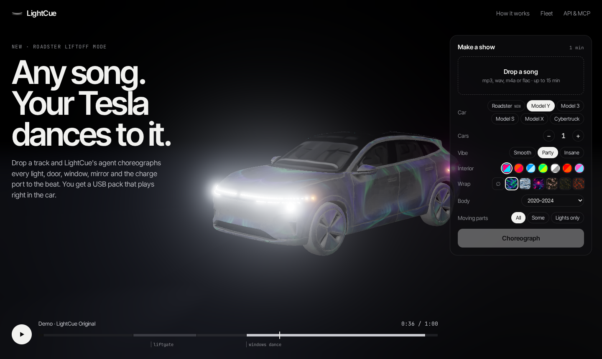
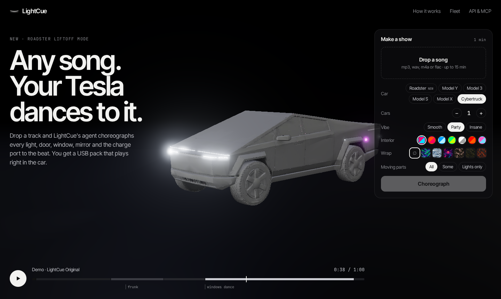
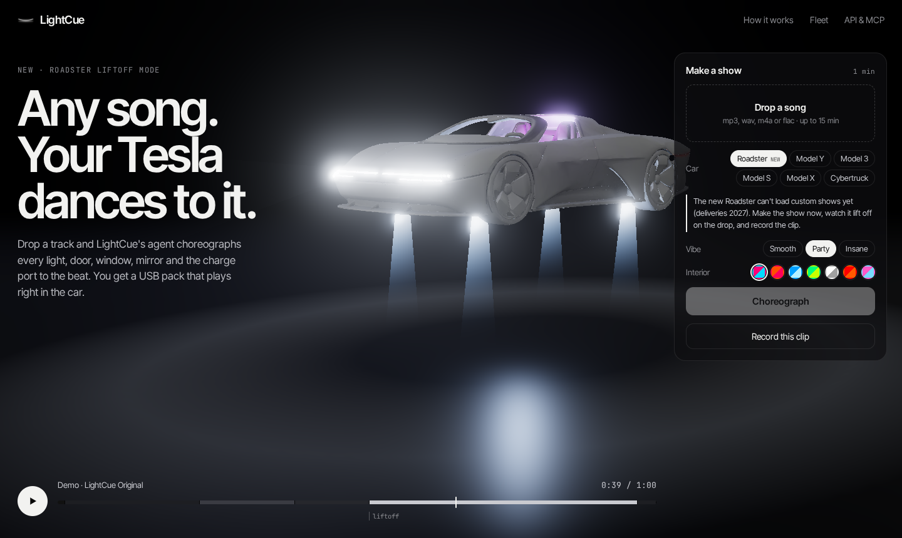

<div align="center">


# LightCue

**Any song in. A Tesla light show out.**

LightCue is an open-source AI choreographer for Tesla vehicles. Drop in a song and it listens to the track
(tempo, every kick and hi-hat, the build-ups and the drops), writes a light show for every light and moving
part on the car, checks it against Tesla's rules, and gives you a USB pack that plays in Toybox.

[**lightcue.io**](https://lightcue.io) · [REST API](docs/API.md) · [MCP server](docs/API.md#mcp-server) · [Show format](docs/SHOW-FORMAT.md) · [Roadmap](docs/ROADMAP.md)

   



</div>

---

## Contents

- [What it does](#what-it-does)
- [Supported vehicles](#supported-vehicles)
- [What's in a pack](#whats-in-a-pack)
- [How it works](#how-it-works)
- [Safety](#safety)
- [Fleet shows](#fleet-shows-212-cars)
- [For AI agents: REST API and MCP](#for-ai-agents-rest-api-and-mcp)
- [Run it yourself](#run-it-yourself)
- [Playing a show in your car](#playing-a-show-in-your-car)
- [Project layout](#project-layout)
- [This is v1](#this-is-v1)
- [FAQ](#faq)
- [Contributing](#contributing)
- [License and trademarks](#license-and-trademarks)

---

## What it does

Since software 11.0, Tesla vehicles can play custom light shows: a `.fseq` sequence plus an audio file on a USB
drive, launched from **Toybox → Light Show**. Making one by hand is a real job. You lay out 200 channels in
xLights frame by frame, learn which byte values mean "ramp on over one second" or "open the liftgate", and
keep count of how many times each door, window and mirror moves so the car doesn't reject the file.

LightCue does all of that automatically:

| You give it | You get back |
|---|---|
| Any song (mp3, wav, m4a, flac, ogg, up to 15 minutes) | A validated Tesla `.fseq` show at 50 fps, timed to the beat |
| Your car (Model 3, Y, S, X, Cybertruck) | Choreography that uses that car's lights, light bars and moving parts |
| A vibe: *Smooth*, *Party* or *Insane* | Section-by-section moods: intro, breathe, pulse, build, party, strobe, outro |
| An interior palette | Interior ambient RGB colour changes in time with the music |
| How much moves: *All*, *Some* or *Lights only* | Closure choreography kept inside Tesla's per-show limits |
| Optional: a wrap | A Paint Shop wrap PNG fitted to your exact body variant |
| Optional: 2–12 cars | A synchronised fleet show, with a different part for each car |

Every pack also includes a **custom lock sound**: two seconds cut from the song's hook, ready for
**Toybox → Boombox → Lock Sound**.

The website at [lightcue.io](https://lightcue.io) runs the whole thing in the browser with a live 3D
preview. The car on screen plays the show exactly as it was written, light by light and door by door,
so you see what you get before you copy anything to a USB drive.

<table>
<tr>
<td width="50%"><br /><sub>Cybertruck: the front and rear light bars are driven as individual pixels.</sub></td>
<td width="50%"><br /><sub>Roadster preview mode: the car lifts off on the song's biggest drop.</sub></td>
</tr>
</table>

---

## Supported vehicles

Tesla's light-show format is shared across its current lineup, so **one engine covers every supported
Tesla**. What changes from car to car is which lights exist and which parts can move. LightCue keeps a
profile for each model and only writes to channels that car actually has.

| Vehicle | Software | Lights | Moving parts LightCue choreographs | Notes |
|---|---|---|---|---|
| **Model 3** (2017+, incl. 2024+ "Highland") | 11.0+ | Headlights (low, high, signature), fogs, turn signals, side markers, repeaters, tail, brake, reverse, plate | Mirrors, all four windows, charge port (incl. rainbow), trunk | Wrap templates for 2017–2023, 2024+ and 2024+ Performance |
| **Model Y** (2020+, incl. 2025+ "Juniper" and Model Y L) | 11.0+ | Same as Model 3 | Mirrors, windows, charge port, liftgate | Wrap templates for 2020–2024, 2025+ Standard, Premium, Performance and Model Y L |
| **Model S** (2021+) | 11.0+ | Full exterior set | Mirrors, windows, charge port, liftgate, **door handles** | Wrap templates for 2021–2024 and 2025+ Plaid |
| **Model X** (2021+) | 11.0+ | Full exterior set | Mirrors, windows, charge port, liftgate, **falcon wing doors** | Windows never move while the falcon doors move |
| **Cybertruck** | 11.0+ | Full exterior set, **front and rear light bars as individual pixels**, off-road lights | Mirrors, windows, charge port, frunk | Light-bar chases, sweeps and VU meters |
| **Roadster** (2nd gen) | n/a | Preview only | Liftoff animation on the biggest drop | Tesla hasn't published a light-show format for it yet. See [roadmap](docs/ROADMAP.md) |

Older Model S and Model X (pre-2021) don't support custom light shows. That's a Tesla limitation, not a
LightCue one.

### Interior lighting

Cars with ambient RGB interior lighting get their own track. The interior colour follows the beat in the
energetic sections, breathes slowly in quiet ones, and goes white on the hits. You choose from seven
palettes: Neon, Sunset, Ice, Forest, Mono, Inferno and Candy.

### Wraps for every body

Tesla publishes a separate wrap template for each body variant: twelve in all, from the 2017 Model 3 to
the Model Y L. LightCue fits its wrap artwork to the exact template for your car, keeps it inside Tesla's
1 MB and 512–1024 px limits, and puts it in the pack's `Wraps/` folder. In v1 there are six designs:
Aurora, Liquid Chrome, Synthwave, Sakura, Carbon Gold and Lava.

---

## What's in a pack

```
YourSong.zip
├── LightShow/
│   ├── YourSong.fseq      ← the light show (Tesla FSEQ v2, 200 channels, 20 ms steps, validated)
│   └── YourSong.wav       ← the audio as WAV (Tesla's recommended format), same name as the show
├── LockChime.wav          ← 2 s cut from the hook, for Toybox → Boombox → Lock Sound
├── Wraps/
│   └── YourSong.png       ← optional, fitted to your exact body variant
└── README.txt             ← how to load it, plus what this particular show does
```

Fleet packs contain one `Car_1/`, `Car_2/`, … folder per car, each with its own `LightShow/` folder.

---

## How it works

LightCue is a three-stage pipeline. Each stage is a plain module you can call on its own.

```
 song ─▶ [1. Listen]  analyze.py ───▶ analysis.json
              tempo · beats · downbeats · kicks/snares/hats · sections · drops · per-frame energy
                                │
                                ▼
         [2. Choreograph] choreo.js ──▶ 200 channels × N frames
              moods per section · light chases · closure moves · interior RGB · light bars · limits
                                │
                                ▼
         [3. Package]   fseq.js + pack.js ──▶ validated .fseq + wav + lock chime + wrap → zip
```

### 1. Listen: `engine/analyze.py`

Pure NumPy, no heavyweight audio libraries. The song is decoded with ffmpeg (locked down to local files and
audio formats only), resampled to 22 050 Hz and analysed on a 441-sample hop. That's exactly **50 frames per
second, one analysis frame per Tesla show frame**, so nothing is ever resampled or rounded between
"what the music does" and "what the car does".

- **Tempo**: autocorrelation of the spectral-flux onset envelope, searched from 60 to 200 BPM with a soft
  prior around 120 BPM to avoid half- and double-time errors.
- **Beats**: dynamic-programming beat tracker (Ellis-style) that balances onset strength against a
  steady tempo.
- **Kick alignment**: the beat grid is then shifted onto the actual kick drum. LightCue looks at the
  40–100 Hz band, tries offsets up to half a beat either way, and keeps the shift if it matches the kicks
  clearly better. Brake-light hits land on the kick you hear, not 30 ms beside it.
- **Downbeats**: of the four possible bar phases, the one with the strongest low-band hits wins.
- **Drums**: separate kick, snare and hi-hat onsets from band-limited flux.
- **Sections and drops**: a checkerboard-kernel novelty curve over a self-similarity matrix finds the
  section boundaries. Each section gets an energy level, and big jumps in energy after a quiet stretch are
  marked as drops.
- **Per-frame features**: energy, low/mid/high band levels and onset strength for every frame. These drive
  the continuous effects.

### 2. Choreograph: `engine/choreo.js`

The choreographer works in two passes.

**Direction.** `directRules()` turns the song's sections into a plan by giving each section a mood:

| Mood | When | What the car does |
|---|---|---|
| `intro` | Opening | Signature lights fade up and parking lights breathe |
| `breathe` | Quiet sections | Slow ramps, interior colour drift |
| `pulse` | Steady groove | Lights on the beat, alternating left/right |
| `build` | Rising energy before a drop | Accelerating chases, then a **blackout right before the drop** |
| `party` | Full energy | Brake, tail and reverse lights on every kick, a light comet running across the front on 16th notes, repeaters and side markers on hi-hats, turn signals on snares |
| `strobe` | The biggest drops (Insane vibe) | Full-car hits on every beat |
| `outro` | Ending | Everything ramps down in order |

The plan is just data, so a smarter director such as a language model or a hand-edited plan can replace
the rules without touching the rest of the engine. `choreograph(analysis, { plan })` accepts one directly.

**Rendering.** The plan is rendered onto Tesla's 200 channels:

- **Lights** use Tesla's built-in ramps (500, 1000 or 2000 ms fades, or instant), picked to suit the
  tempo, so fades look smooth in the car and not stepped.
- **Moving parts** are placed on musical moments: the liftgate opens on the build and dances on the drop,
  windows dance in bar-length phrases, mirrors fold on downbeats, and the charge port goes rainbow on the
  last drop. Each move respects how long the part physically takes (the liftgate needs ~14 s to open,
  falcon doors ~20 s).
- **Cybertruck light bars** are treated as pixel strips, so chases travel across the bar and
  energy-driven meters grow from the centre.
- **Tidy pass**: minimum on/off times are enforced so nothing flickers faster than the car's lights can
  render.

Shows are **deterministic**: the same song and settings, with the same seed, always produce the same show.

### 3. Package: `engine/fseq.js`, `engine/pack.js`

- Writes **FSEQ v2, uncompressed, 200 channels, 20 ms steps**, the exact variant Tesla's car software
  reads, with the media filename in the variable header.
- Runs the **validator** (below) and refuses to ship a file that fails.
- Cuts the lock chime from the strongest repeated section (the hook), with fades, as a 2 s WAV.
- Composes the wrap (`engine/wrap.py`): fits the artwork into the template's paintable alpha and
  re-quantises it if the PNG would go over 1 MB.
- Zips everything with a per-pack README.

### The 3D preview: `web/`

The site is hand-built with Vite and three.js.

- **Car models**: each body (crossover, sedan, truck, roadster) was generated as an image, turned into a
  3D mesh, then decimated and Draco-compressed in Blender to ~0.5 MB (`brand/blender/prep*.py`).
- **Emulator**: `engine/emulate.js` decodes the same `.fseq` the car will read, including ramps and
  closure state machines, and drives the lamps, beams, interior light and moving parts. **The preview is
  rendered from the file, not from a separate animation.**
- **Wraps**: a triplanar shader paints the wrap artwork onto the body in real time, so you can switch
  designs while the show plays.
- **Live re-choreography**: changing the vibe, palette or moving parts re-runs the choreographer in the
  browser instantly. The server is only needed for the audio analysis and the final pack.
- **Clip recording**: record the canvas and the audio to an MP4 (H.264 + AAC) to share.

---

## Safety

Light shows move real hardware, so LightCue enforces Tesla's rules in code, before export.

| Rule | How LightCue handles it |
|---|---|
| Per-show command limits: liftgate 6, front doors 6, falcon doors 6, windows 6, mirrors 20, door handles 20, charge port 3 | Counted while the show is written, then checked again by the validator. A show over the limit is never exported |
| Closure "dance" moves under 30 s | Every dance is clipped well inside the limit |
| Model X: windows must not move while the falcon doors move | The choreographer blocks window moves during falcon motion |
| Parts take time to move | Moves are scheduled using each part's real travel time (`MOVE_S` in `engine/channels.js`) |
| End state | Mirrors end unfolded and handles end retracted, and the charge port opens before it dances and closes again afterwards |
| File format | FSEQ v2, uncompressed, 200 channels, 20 ms steps. The validator also checks the header, channel count, step time, length and data integrity |
| "I don't want anything to move" | Pick **Lights only**: no closure channel is ever written |

You can validate any `.fseq`, including ones you didn't make with LightCue:

```bash
curl -X POST https://lightcue.io/api/v1/validate --data-binary @myshow.fseq
```

> **Always park somewhere with room around the car.** Doors, the liftgate and mirrors will move. Stay clear
> of the car while a show runs, and use *Lights only* in tight spaces.

---

## Fleet shows (2–12 cars)

Set the number of cars and LightCue writes a **different part for each car**, the way an arranger splits a
song between instruments.

- **Chases travel from car to car**: a headlight sweep can start at car 1 and finish at car 6.
- **Hits land together**: drops and downbeats fire on every car at once.
- **Each interior gets its own colour** from the palette, so the line reads as a gradient.
- **Mixed fleets work**: a Model X, two Model Ys and a Cybertruck each get choreography for their own
  hardware.
- **Syncing**: park the cars in order, load each car's folder, and use **Schedule Show** to set the same
  start time on each (up to 10 minutes ahead). Tesla starts every scheduled show on the clock, so the cars
  play as one.

Good for car meets, weddings, launches, dealer events and owners' club displays.

---

## For AI agents: REST API and MCP

LightCue is built to be called by software, not just people. An assistant such as Claude, ChatGPT or your
own agent can take "make my Model Y dance to this song" and return a validated pack.

### MCP server

Add LightCue to any MCP client (streamable HTTP):

```json
{
  "mcpServers": {
    "lightcue": { "url": "https://lightcue.io/mcp" }
  }
}
```

| Tool | What it does |
|---|---|
| `list_options` | Cars, vibes, palettes, closure modes, wraps and the wrap body variants per car |
| `create_light_show` | Starts a show from an `audio_url`, for one car or a fleet of up to 12. Returns a job id |
| `get_light_show` | Job status. When done: download link, preview page, song analysis and show notes |
| `validate_fseq` | Checks any `.fseq` (by URL) against Tesla's rules |

### REST API

```bash
# 1. Upload a song (or POST JSON {"audio_url": "https://…"})
curl -X POST "https://lightcue.io/api/v1/shows?car=cybertruck&vibe=insane&palette=ice&wrap=chrome" \
  -H "content-type: audio/mpeg" --data-binary @song.mp3
# → 202 { "id": "x7Kq…", "status": "queued", … }

# 2. Poll
curl https://lightcue.io/api/v1/shows/x7Kq…
# → { "status": "done", "download": "…/download", "preview": "https://lightcue.io/s/x7Kq…", "notes": [ … ] }

# 3. Download the USB pack
curl -L -o show.zip https://lightcue.io/api/v1/shows/x7Kq…/download
```

Full reference, including fleets, every parameter, response shapes, limits and errors:
**[docs/API.md](docs/API.md)**.

---

## Run it yourself

### Requirements

- **Node.js 20+**
- **Python 3.10+** with **NumPy** and **Pillow** (`pip install -r requirements.txt`)
- **ffmpeg** on your `PATH`

### Setup

```bash
git clone https://github.com/wmorrill3/lightcue.git
cd lightcue
npm install
pip install -r requirements.txt
npm run setup        # downloads Tesla's official wrap templates into engine/wraps/
npm test             # 11 engine tests
```

### Make a show from the command line

```bash
npm run pack -- path/to/song.mp3 modely party neon
# → data/out/song-modely/song.zip, plus a JSON summary: BPM, sections, notes, validation
```

Arguments: `<audio> [car] [vibe] [palette]`. Cars: `model3 modely models modelx cybertruck`. Vibes:
`smooth party insane`. Palettes: `neon sunset ice forest mono inferno candy`.

### Run the site, API and MCP server

```bash
cp .env.example .env
npm run build        # builds the web app into web/dist
npm start            # http://localhost:3150  (API at /api/v1, MCP at /mcp)
```

For development, `npm run dev` serves the front end with hot reload. Run `npm start` alongside it for the
API.

The server binds to `127.0.0.1`. To go public, put a reverse proxy in front. With Caddy, this is all you need:

```
yourdomain.com {
	encode zstd gzip
	request_body {
		max_size 45MB
	}
	reverse_proxy 127.0.0.1:3150
}
```

### Use the engine as a library

```js
import { buildPack } from './engine/pack.js';

const { zipPath, analysis, show, validation } = await buildPack({
  audioPath: 'song.mp3',
  title: 'My Show',
  model: 'modelx',
  vibe: 'party',
  palette: 'sunset',
  closures: 'all',        // 'all' | 'safe' | 'none'
  outDir: 'out/my-show',
});
```

Lower-level pieces are exported too: `analyze()`, `choreograph()`, `choreographFleet()`, `writeFseq()`,
`readFseq()`, `validateFseq()`, `emulate()`.

### Configuration

| Variable | Default | Purpose |
|---|---|---|
| `PORT` | `3150` | HTTP port (binds `127.0.0.1`) |
| `SITE_URL` | `http://localhost:3150` | Public URL used in API responses and share links |
| `API_KEYS` | *(empty)* | Comma-separated keys. `x-api-key` callers get 500 shows/hour instead of 20 |

Built-in limits: 15-minute songs, 40 MB uploads, 4 concurrent jobs, a 60-job queue and a 6 GB disk cap.
Jobs and uploads are deleted after 7 days.

---

## Playing a show in your car

1. Format a USB drive as **exFAT** or **FAT32** (not NTFS). Don't use the drive that holds your TeslaCam
   footage.
2. Unzip the pack to the **root** of the drive, so `LightShow/` sits at the top level.
3. Plug it into a front USB port and wait a few seconds.
4. In the car: **Toybox → Light Show → Schedule Show**. Choose your show from the drop-down, then start it
   or schedule it.
5. Optional: **Toybox → Boombox → Lock Sound** to use `LockChime.wav`, and **Toybox → Paint Shop → Wraps**
   to apply your wrap.

Fleet: give each car its own drive with its `Car_N` folder copied to the root, then schedule the same
start time on every car.

---

## Project layout

```
engine/            The core. Usable without the server.
  analyze.py         song → beats, sections, drops, per-frame features (NumPy)
  choreo.js          analysis → plan → 200-channel frames, fleet splitting, vehicle profiles
  channels.js        Tesla channel map, byte values, ramps, closure limits, travel times
  fseq.js            FSEQ v2 writer, reader and validator
  emulate.js         plays an .fseq back as light intensities and closure states
  pack.js            end to end: analyze → choreograph → validate → zip
  wraps.js, wrap.py  wrap gallery, body variants, template fitting
  wrap-art/          wrap artwork
  cli.js             command-line pack builder
server/            Express 5 app
  api.js             REST API v1
  mcp.js             MCP server (streamable HTTP, stateless)
  jobs.js            job queue, capacity limits, expiry
  fetchsafe.js       SSRF-safe downloader for audio_url
web/               Vite + three.js site: studio, 3D stage, emulator-driven preview, recorder
  public/models/     Draco-compressed car bodies
  public/demo/       demo track and show
brand/             logo, social image, Blender prep scripts for the car models
scripts/           setup helpers
test/              engine tests (format, validator, limits, choreography)
docs/              API reference, show format notes, roadmap
```

---

## This is v1

LightCue v1 does one thing end to end and does it properly: **song in, validated show out, for every Tesla
that supports light shows, with a preview you can trust.** The engine, the format handling and the safety
rules are solid. A lot is deliberately left for later:

- **Rule-based direction.** v1 uses a hand-tuned rule set to choose moods. Next: an AI director that
  reads the song's structure (and the lyrics, if you want) and writes a plan with intent, like "save the
  falcon doors for the final chorus".
- **Six wraps.** Next: custom wraps generated from a prompt, fitted to your exact body.
- **Not yet verified on every model and year.** The format is shared and every show passes the
  validator, but this is a young project. Please report anything that looks different in the car than in
  the preview.
- **Roadster is preview-only** until Tesla publishes its channel map.
- **No editor yet.** v1 is fully automatic. Next: a timeline where you can nudge a cue, lock a section or
  paint a moment by hand.
- **No accounts or library.** Packs expire after 7 days.

The full list is in **[docs/ROADMAP.md](docs/ROADMAP.md)**.

---

## FAQ

**Is it safe for my car?**
Shows use Tesla's own light-show format and are validated against Tesla's command limits before you can
download them. The car's own software also enforces those limits. Moving parts do move, so park with
clearance, or pick *Lights only*.

**Will this void my warranty?**
Custom light shows are a feature Tesla built and documents publicly. LightCue only creates the files that
feature reads. It doesn't modify the car's software.

**Does it work on my 2019 Model S?**
No. Tesla supports custom light shows on Model S and Model X from 2021 onward, and on all Model 3, Model Y
and Cybertruck vehicles running software 11.0 or newer.

**Why does my song not appear in the car?**
Check that the drive is exFAT or FAT32, that `LightShow/` is at the root, that the `.fseq` and `.wav`
names match (LightCue does this for you), and that the drive has no TeslaCam or firmware-update files.

**Can I edit the show in xLights?**
Yes. The `.fseq` is a standard xLights FSEQ v2 file.

**What happens to my song?**
On lightcue.io, uploads are used to make your show and then deleted. Preview audio and packs expire after
7 days. If you self-host, everything stays on your machine.

**Does it work for the new Roadster?**
Not in the car yet: Tesla hasn't published a Roadster light-show format. Pick Roadster on the site to watch
your show with a liftoff on the drop.

---

## Contributing

Issues and pull requests are welcome. Things that help most right now:

- **Real-car reports.** Model, year, software version, and what matched or didn't match the preview.
  A short video is gold.
- **Choreography ideas**: new moods, better closure moments, model-specific tricks.
- **Analysis improvements** for tricky genres (half-time trap, rubato, live recordings).
- **Wrap artwork.**

Run `npm test` before you open a PR. Anything that changes `channels.js`, `fseq.js` or the closure logic in
`choreo.js` needs a test, because those decide what the car's hardware does.

---

## License and trademarks

LightCue is released under the [MIT License](LICENSE).

LightCue is an independent project and is **not affiliated with, endorsed by or sponsored by Tesla, Inc.**
Tesla, Model 3, Model Y, Model S, Model X, Cybertruck and Roadster are trademarks of Tesla, Inc. Tesla's
wrap templates are downloaded from Tesla's public
[custom-wraps](https://github.com/teslamotors/custom-wraps) repository at setup and are not redistributed
here. The show format follows Tesla's public [light-show](https://github.com/teslamotors/light-show)
documentation.
